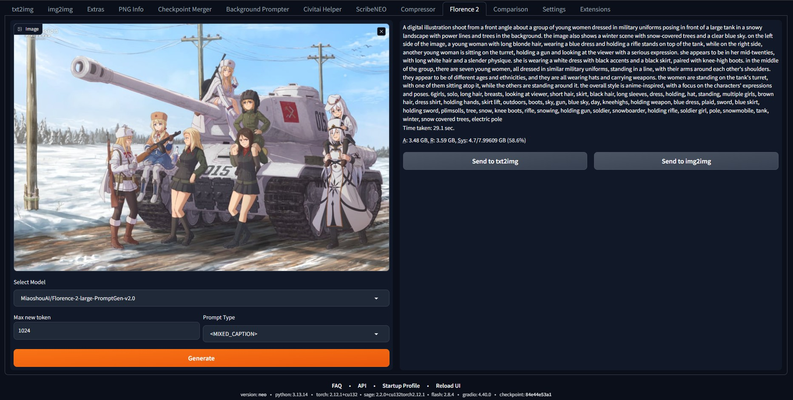

# sd-webui-florence-2

[English](README.md) **|** [中文](README_JP.md)

**sd-webui-florence-2** can identify the content of images and describe them in natural language.

## Changes from the original version

Modified for use with [SD WebUI Forge Neo](https://github.com/Haoming02/sd-webui-forge-classic)  
Modifications based on [ComfyUI-Florence2 v1.0.7](https://github.com/kijai/ComfyUI-Florence2/tree/6c766b13f4908a86cfbd6357d6d485c80e0f3a2f)

## Installation

> video: [https://www.bilibili.com/video/BV1JV8fePE6M/](https://www.bilibili.com/video/BV1JV8fePE6M/)

1. Extensions -> Install from URL -> Enter URL of this repository -> Press Install button or clone this repository under extensions/

```bash
git clone https://github.com/ilyq/sd-webui-florence-2 extensions/sd-webui-florence-2
```

## Settings

If you wish to change the default values ​​selected on the Florence 2 tab (or any other tab), open WebUI Neo: Settings -> Defaults.

## Screenshot



## Reference

[https://huggingface.co/microsoft/Florence-2-large](https://huggingface.co/microsoft/Florence-2-large)

## Some of the Florence-2 models on Hugging Face

[MiaoshouAI/Florence-2-large-PromptGen-v2.0](https://huggingface.co/MiaoshouAI/Florence-2-large-PromptGen-v2.0) - recommended  
[MiaoshouAI/Florence-2-base-PromptGen-v2.0](https://huggingface.co/MiaoshouAI/Florence-2-base-PromptGen-v2.0) - recommended  
[gokaygokay/Florence-2-Flux-Large](https://huggingface.co/gokaygokay/Florence-2-Flux-Large)  
[thwri/CogFlorence-2.2-Large](https://huggingface.co/thwri/CogFlorence-2.2-Large)  
[ljnlonoljpiljm/florence-2-large-nsfw-pretrain](https://huggingface.co/ljnlonoljpiljm/florence-2-large-nsfw-pretrain)  
[microsoft/Florence-2-large-ft](https://huggingface.co/microsoft/Florence-2-large-ft)  
[microsoft/Florence-2-base-ft](https://huggingface.co/microsoft/Florence-2-base-ft)  
