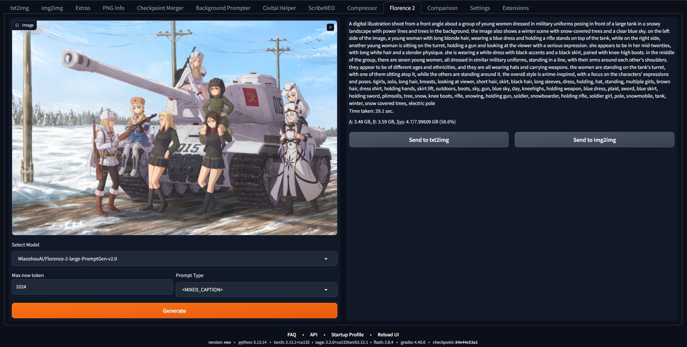

# sd-webui-florence-2

[中文](README.md) **|** [English](README_EN.md)

**sd-webui-florence-2** 能够解析并反推出图片中的内容

## オリジナル版からの変更点

使用のために変更されました [SD WebUI Forge Neo](https://github.com/Haoming02/sd-webui-forge-classic).  
変更は以下に基づいています [ComfyUI-Florence2 v1.0.7](https://github.com/kijai/ComfyUI-Florence2/tree/6c766b13f4908a86cfbd6357d6d485c80e0f3a2f)

注：WebUI Forge Neoのルートディレクトリにあるui-config.jsonファイルで、Florence 2タブで選択されているデフォルト値を変更できます。

```text
    "florence/Select Model/visible": true,
    "florence/Select Model/value": "MiaoshouAI/Florence-2-large-PromptGen-v2.0",
    "florence/Max new token/visible": true,
    "florence/Max new token/value": 1024,
    "florence/Prompt Type/visible": true,
    "florence/Prompt Type/value": "<MORE_DETAILED_CAPTION>",
    "florence/Generate/visible": true,
    "florence/Send to txt2img/visible": true,
    "florence/Send to img2img/visible": true
```

## 安装

> 视频教程: [https://www.bilibili.com/video/BV1JV8fePE6M/](https://www.bilibili.com/video/BV1JV8fePE6M/)

1. Extensions -> Install from URL -> Enter URL of this repository -> Press Install button or clone this repository under extensions/

```bash
git clone https://github.com/ilyq/sd-webui-florence-2 extensions/sd-webui-florence-2
```

## 重要说明

1. transformers 版本

   1.1. 旧版本 transformers 不支持 Florence-2, 旧版本会出现以下报错:

   ```text
   TypeError: Object of type Florence2LanguageConfig is not JSON serializable
   ```

   1.2. Automatic1111's Web UI 在 requirements.txt 和 requirements_versions.txt 文件中指定了 transformers 的旧版本 4.30.2.  
   1.3. 更新 Transformers 版本可能会引发其他错误，请自行测试

2. 模型保存目录: `models/LLM`

## Screenshot



## 参考

[microsoft/Florence-2-large](https://huggingface.co/microsoft/Florence-2-large)

## Hugging Faceに掲載されている「Florence-2」モデルの一部

[MiaoshouAI/Florence-2-large-PromptGen-v2.0](https://huggingface.co/MiaoshouAI/Florence-2-large-PromptGen-v2.0) - 推奨  
[MiaoshouAI/Florence-2-base-PromptGen-v2.0](https://huggingface.co/MiaoshouAI/Florence-2-base-PromptGen-v2.0) - 推奨  
[gokaygokay/Florence-2-Flux-Large](https://huggingface.co/gokaygokay/Florence-2-Flux-Large)  
[thwri/CogFlorence-2.2-Large](https://huggingface.co/thwri/CogFlorence-2.2-Large)  
[ljnlonoljpiljm/florence-2-large-nsfw-pretrain](https://huggingface.co/ljnlonoljpiljm/florence-2-large-nsfw-pretrain)  
[microsoft/Florence-2-large-ft](https://huggingface.co/microsoft/Florence-2-large-ft)  
[microsoft/Florence-2-base-ft](https://huggingface.co/microsoft/Florence-2-base-ft)  
